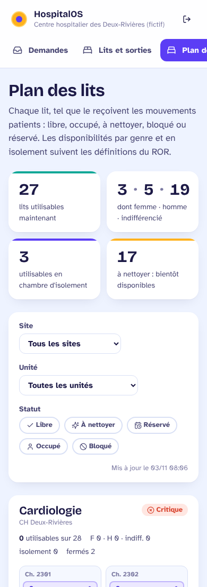
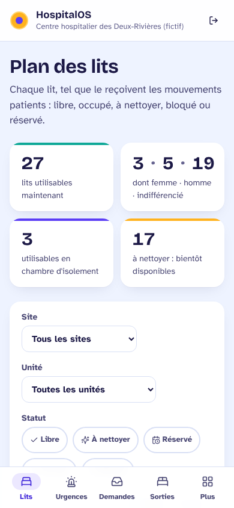
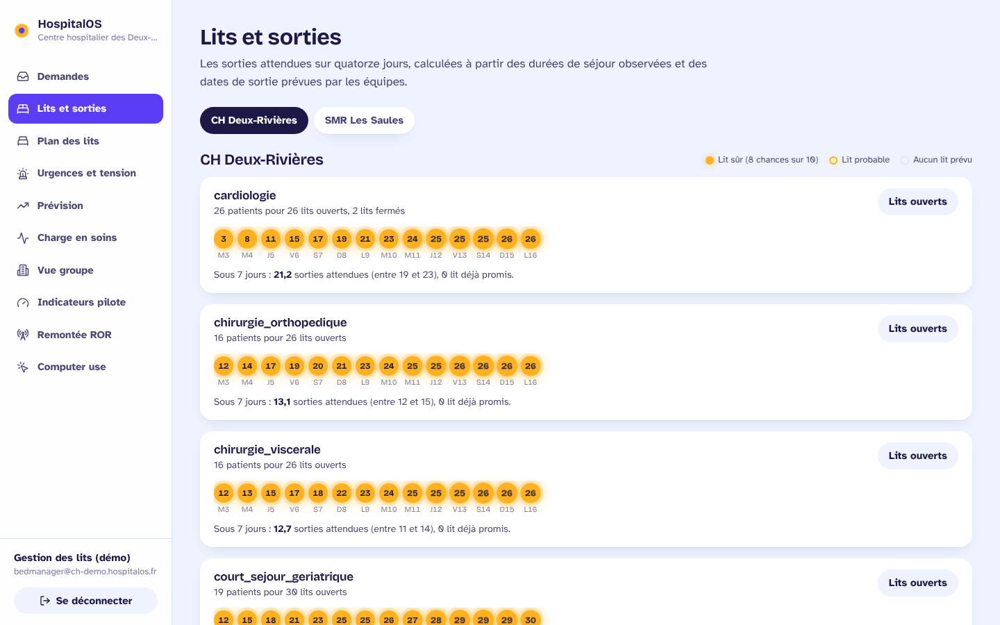
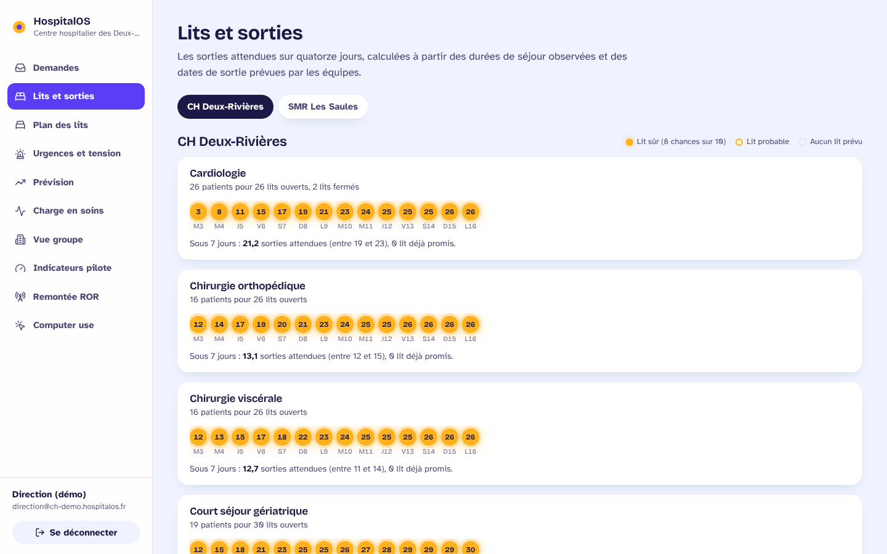

# Revue UX de l'interface web (novembre 2026)

Périmètre : `services/admissions_web`, sur la démo LISCOP (CH Deux-Rivières, SMR Les
Saules), en 1440 px et 390 px, avec les comptes `bedmanager@`, `cadre@`, `direction@`
et `admin@`. La revue s'appuie sur les captures d'écran, un audit WCAG 2.1 AA (contrastes
calculés, cibles mesurées dans Chromium) et le code.

## Personas

Il n'existe pas encore de document de personas. Ceux-ci sont déduits des rôles
(`admissions_smr/README.md`), du scénario de démo (`docs/liscop/DEMO.md`) et des specs.
**À valider avec deux ou trois utilisateurs réels.**

| Persona | Rôle | Contexte d'usage | Ce qui compte |
|---|---|---|---|
| **Gestionnaire de lits** (cellule de gestion des lits) | `coordination` | Bureau, deux écrans, téléphone qui sonne sans arrêt ; écran ouvert toute la journée ; pic entre 8 h et 10 h (recensement de 10 h, staff) | Voir d'un coup d'œil ce qui a changé depuis son dernier regard ; savoir si l'écran est à jour ; agir vite sur un lit |
| **Cadre de santé** d'unité | `coordination` limité à un site | Debout, en tournée, tablette au chariot ou téléphone ; sessions de 30 s ; parfois avec des gants | Son unité d'abord, gros boutons, peu de texte, pas de défilement inutile |
| **Direction** (directeur de garde, direction des soins) | `direction` (lecture) | Réunions, téléphone ; consultation quotidienne ; décide de l'HET ou du plan blanc | Des chiffres cohérents et datés, la tendance, la décision qui lui revient |
| **Administrateur** du groupe | `admin_groupe` | Bureau ; paramétrage, connexions, agent | Contrôler l'agent (player), comprendre une erreur, ne rien casser |

## Critique

### Première impression

Le système visuel est solide et chaleureux : la police Atkinson Hyperlegible, choisie
pour la lisibilité, des jetons cohérents, des panneaux aérés, un focus visible, le lien
« Aller au contenu » et un `prefers-reduced-motion` global. Les écrans clés (plan des
lits, urgences) placent bien les chiffres en premier. Le plus gros potentiel est
ailleurs : **le direct** (rien ne dit ce qui a changé ni si c'est à jour) et **le
téléphone** (navigation et longueur des pages).

### Utilisabilité

| Constat | Gravité | Fait / recommandation |
|---|---|---|
| Navigation sur téléphone : bandeau de 10 onglets qui défile hors de l'écran (« Plan d… »), sans indice ; inatteignable au pouce | 🔴 | **Fait** : barre d'onglets en bas, 4 écrans par persona, le reste derrière « Plus » |
| Le direct ne dit pas ce qui a bougé : après un appel, le gestionnaire doit comparer de mémoire | 🔴 | **Fait** : écart signé pendant 2 minutes et halo bref sur les compteurs ; signal sur la tuile d'un lit qui change de statut |
| « Mis à jour le 03/11 08:06 » : il faut calculer soi-même l'âge de la donnée ; un écran figé (réseau coupé) ressemble à un écran à jour | 🟡 | **Fait** : « À jour · il y a 2 minutes », et « Données en retard » au-delà de 3 minutes |
| Urgences : « lits brancards à 10 h » vaut 1 sur la carte et 8 dans l'aide HET (avant 10 h, l'aide prend la valeur d'hier), sans explication | 🟡 | **Fait** : « relevé d'hier : 10 h n'est pas encore passé » sous le critère |
| Lits et sorties : unités affichées en code brut (`chirurgie_orthopedique`) | 🟡 | **Fait** : libellé du vocabulaire, code inconnu rendu lisible |
| Plan des lits sur téléphone : 11 865 px de haut, 2 chambres par ligne ; le cadre refait le filtre d'unité à chaque visite | 🟡 | **Fait** : 3 chambres par ligne (8 545 px), introduction raccourcie, site et unité mémorisés sur le poste |
| Player : clignotement image / vide à chaque étape sans capture | 🟢 | **Fait** : la dernière image reste affichée, atténuée, avec une mention |
| « Computer use » ne parle pas aux cadres ni à la direction | 🟢 | Abrégé « Agent » dans la barre mobile ; **à décider** : un nom métier (« Agent de relève » ?) |

### Hiérarchie visuelle

- **Ce qui attire l'œil d'abord** : les grands chiffres des cartes, à juste titre.
- **Ordre de lecture** : chiffres, filtres, puis détail par unité. Il est bon sur le
  bureau. Sur téléphone, le paragraphe d'introduction repoussait les chiffres (il est
  raccourci).
- **À reprendre** : sur le plan des lits, « Ch. 2301 » et le lit « 2301 » se répètent
  pour chaque chambre seule ; les lits occupés (la majorité) ont autant de poids visuel
  que les lits libres, alors que ce sont les libres qu'on cherche (piste : atténuer
  « occupé »).

### Cohérence

| Élément | Constat | Recommandation |
|---|---|---|
| Couleurs des axes de graphiques | Codées en dur (`#7D7BA3`) au lieu des jetons | Corrigé en valeur ; à terme, lire les jetons depuis la configuration Tailwind |
| Écart signé | Vert pour « + », jaune pour « − » : un jugement faux (moins de lits à nettoyer, c'est une bonne nouvelle) | Une seule couleur neutre ; le signe dit ce qui a bougé |
| Formatage | Pas de Prettier configuré : 50 fichiers hors style | Ajouter `.prettierrc` et un contrôle en CI (à valider : nouvelle dépendance de CI) |

## Audit d'accessibilité (WCAG 2.1 AA)

### Contrastes (calculés)

| Élément | Avant | Après | Exigé |
|---|---|---|---|
| `ink-faint` sur le fond (horodatages, légendes, axes) | 3,61:1 ❌ | 4,99:1 ✅ | 4,5:1 |
| `ink-faint` sur blanc | 4,01:1 ❌ | 5,54:1 ✅ | 4,5:1 |
| `coral-dark` sur `coral-soft` (« Critique », erreurs) | 3,69:1 ❌ | 5,04:1 ✅ | 4,5:1 |
| `lagoon-dark` sur `lagoon-soft` | 4,25:1 ❌ | 5,55:1 ✅ | 4,5:1 |
| Blanc sur corail (« À reprendre », « Tension ») | 2,80:1 ❌ | 5,95:1 ✅ (fond `coral-dark`) | 4,5:1 |
| Blanc sur lagon (« Confirmée ») | 2,97:1 ❌ | 6,39:1 ✅ (fond `lagoon-dark`) | 4,5:1 |
| Blanc sur violet, encre sur soleil | 6,12:1, 9,12:1 ✅ | inchangé | 4,5:1 |

### Cibles tactiles (390 px, mesurées)

Avant : boutons à 39 px, champs à 38 px, filtres de statut à 32 px, bouton de
déconnexion à 36 px. Après : tout contrôle fait au moins 44 px sur écran tactile
(`pointer: coarse`), les onglets du bas 56 px ; la souris garde la densité du bureau.
Après correction, la page des urgences ne compte plus aucune cible sous 44 px.

### Autres points

- ✅ Focus visible, lien d'évitement, régions nommées, transcription du player en texte.
- ✅ Le panneau « Plus » place le focus à l'ouverture, se ferme par Échap ou par le fond,
  et `aria-expanded` est sur son bouton ; « Plus » est marqué actif quand l'écran ouvert
  s'y trouve.
- ⚠️ L'écart signé est aussi porté par `title` (« En hausse de 2 depuis la dernière mise
  à jour ») ; il n'est pas annoncé en direct, volontairement, pour ne pas inonder le
  lecteur d'écran à chaque rafraîchissement. Une annonce récapitulative est à étudier.
- ⚠️ Non testé : lecteurs d'écran réels (NVDA, VoiceOver), zoom à 200 %.

## Animations : le vocabulaire

Le mouvement sert l'usage, il ne décore pas. Il est court, ne tourne jamais en boucle de
lui-même, et `prefers-reduced-motion` le coupe.

| Mouvement | Durée | Sens |
|---|---|---|
| Halo d'un chiffre ou d'un lit qui vient de changer | 1,6 s, une fois | « ceci a bougé pendant que vous ne regardiez pas » |
| Écart signé à côté du chiffre | reste 2 min | assez long pour être vu après un appel |
| Panneau « Plus » qui monte du bas | 220 ms | il vient d'où se trouve le bouton |
| Onde de clic du player (existant) | 900 ms × 2 | le geste de l'agent |
| Allumage des lampes de prévision (existant) | 420 ms | apparition |

## Captures

| Avant | Après |
|---|---|
|  |  |
|  |  |

Également : `apres-panneau-plus-390.png`, `apres-direct-ecarts.png` (un lit d'isolement
nettoyé : +1 utilisable, +1 indifférencié, +1 isolement, −1 à nettoyer),
`apres-het-releve-hier.png`.

## Suite proposée (par impact)

1. **Valider les personas** avec deux ou trois entretiens (un gestionnaire de lits, un
   cadre, un membre de la direction) avant d'aller plus loin.
2. **Plan des lits : atténuer les lits occupés** pour faire ressortir les libres ;
   supprimer la répétition « Ch. 2301 / 2301 » des chambres seules.
3. **Un mode « mur »** pour la cellule de gestion des lits (grand écran, lecture à 3 m,
   défilement automatique des unités en tension).
4. **Annonce récapitulative** pour les lecteurs d'écran (« 3 changements depuis 08:05 »).
5. **Nommer l'agent** dans le langage des équipes (et non « Computer use »).
6. **Prettier en CI** et lecture des couleurs des graphiques depuis les jetons.
